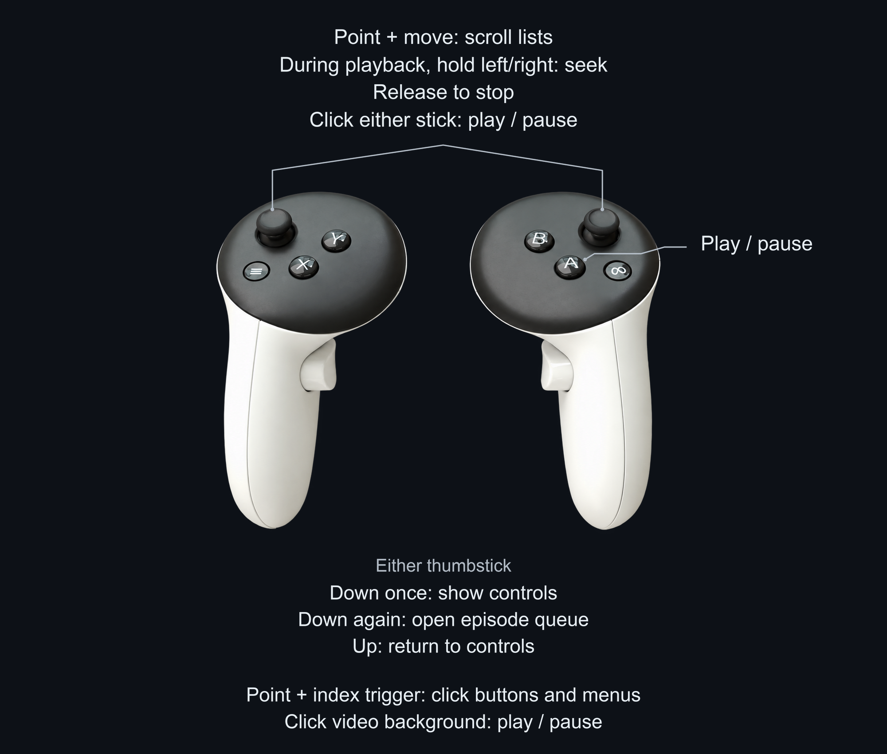

# Plex Quest patch



Patch your own Plex Android APK for TV-style browsing and Quest controller input.
No Plex APK is provided here. The original Play build has been used on Quest 3.
The Meta build has passed patching and standalone-build checks; playback on the
headset still needs verification.

During playback, the first screen-background click or assigned play/pause button
press reveals hidden controls without changing playback. While controls are
visible, further presses toggle play/pause. Once controls hide again, the next
press only reveals them. Clicking a visible control or the timeline still performs
that control's action.

Click the playback timeline with the index trigger to seek to that point.
Either thumbstick seeks ±10 seconds per jump, increasing to ±30 seconds after
2 seconds of holding and ±60 seconds after 5 seconds. Release or change direction
to reset the jump size.

**Supported inputs:**

| Source | Plex version | Version code |
| --- | --- | --- |
| Meta Horizon Store (extract from your Quest) | **2026.18.0** | **971050431** |
| Google Play | **2026.17.0** | **971050399** |

The patcher detects the build automatically. Other versions or store variants are
rejected; a matching version name alone is not enough. Supply a standalone `.apk`
or a complete `.apkm` / `.xapk` containing ARM64 libraries.

## Get the APK from your Quest

Install the supported Plex version from the Meta Horizon Store. On your computer,
enable Quest developer mode and USB debugging, connect the headset, and authorize
ADB in the headset. See the [Android ADB documentation](https://developer.android.com/tools/adb).

You can use an APK extraction/backup tool such as SideQuest or ADB Master, or find
the installed APK with ADB:

```bash
adb shell pm path com.plexapp.android
```

Copy the returned path without the `package:` prefix:

```bash
adb pull /data/app/.../base.apk plex-original.apk
```

The inspected Meta **2026.18.0** build is a complete standalone APK, including ARM64
libraries, so this extracted file can be used directly. If `pm path` returns more
than one APK, pull **all** of them, put them in a ZIP archive, and give that archive
a `.xapk` extension. A split `base.apk` alone is incomplete.

## Patch with GitHub Actions

1. Upload your extracted APK (or complete APKM/XAPK) to a file host that provides a
   **direct download URL accessible to GitHub Actions**, without a browser login.
2. **Fork this repository**, then open **Actions** in **your fork** and enable workflows if prompted.
3. Add the [signing secrets](#signing) to your fork. This is a one-time setup.
4. Open **Actions → Patch Plex APK → Run workflow**. Paste the direct URL to your
   APK/APKM/XAPK file (not a download page), leave **signing enabled**, and run it.
5. When the run finishes, download the **`plex-quest-signed-…`** artifact under **Artifacts** and unzip it.
6. Sideload **`plex-quest-tv-aligned-signed.apk`** onto your Quest. With ADB:

   ```bash
   adb install -r plex-quest-tv-aligned-signed.apk
   ```

The result is **one signed, standalone APK**. It uses `com.plexapp.android.tv`,
with its own login/settings, and can coexist with the official Plex app. Reuse the
same signing key for updates to an existing mod installation.

**Extraction runs on your computer; patching and signing run on GitHub.** The
workflow cannot connect to your headset. It does not automatically download apps
from the Meta Horizon Store or Google Play.

<details>
<summary>Optional: patch and sign locally instead of uploading an APK</summary>

With Python and a Java JDK installed, run:

```bash
python -m pip install -r requirements.txt
python scripts/patch_apk.py --input plex-original.apk --out dist
```

For a split install, add `--split path/to/split.apk` for every configuration APK.
Sign the output with your saved key from the [signing setup](#signing):

```bash
export APK_KEY_ALIAS=plex-quest
read -s -p "Keystore password: " APK_STORE_PASSWORD; echo
export APK_STORE_PASSWORD
python scripts/sign_apks.py --directory dist/unsigned --output dist/signed \
  --keystore plex-quest.p12
adb install -r dist/signed/plex-quest-tv-aligned-signed.apk
```

The password prompt above uses Bash. If your key has a separate key password,
also set `APK_KEY_PASSWORD`. Keep the same keystore for future updates.

</details>

## Signing

<details>
<summary>One-time signing setup</summary>

Android requires a signed APK. On a computer with a Java JDK installed, create
a signing key and choose a password when prompted:

```bash
keytool -genkeypair -keystore plex-quest.p12 -storetype PKCS12 \
  -alias plex-quest -keyalg RSA -keysize 4096 -validity 10000 \
  -dname "CN=Plex Quest"
```

Convert the key file to a single Base64 line:

```bash
base64 < plex-quest.p12 | tr -d '\n'
```

In **your fork**, go to **Settings → Secrets and variables → Actions → New repository secret**
and add:

| Secret | Value |
| --- | --- |
| `APK_KEYSTORE_BASE64` | The Base64 output above |
| `APK_KEY_ALIAS` | `plex-quest` |
| `APK_STORE_PASSWORD` | The password you chose |

If using an existing keystore with a different key password, also add `APK_KEY_PASSWORD`.
Keep your key file and password for future updates.

</details>

---

Unofficial; not affiliated with Plex. The [MIT license](LICENSE) covers this tooling,
not Plex or generated APKs.
